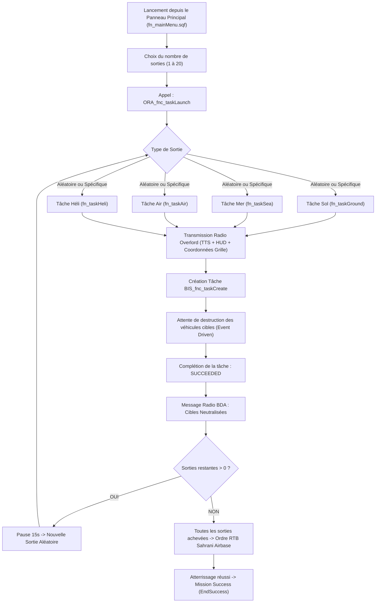

# 📐 INFO_TASK_DEV.md — Architecture & Spécifications du Système de Tâches ORA

> **Projet :** ORA - Air Force (Sahrani)  
> **Auteur :** ORA SQF Architect  
> **Référence :** `INFO_TASKS.md`, `INFO_ENNEMIS.md`, `TTS.md`, `INFO_EDITOR.md`  
> **Environnement :** Arma 3 — Single-Player exclusif, exécution locale optimisée, typage strict SQF.

---

## 1. Philosophie & Contraintes Opérationnelles

Le joueur incarne `player_0`, pilote de chasse au manche d'un jet multirôle (`plane_0` - JAS-39 Gripen RACS) évoluant à des vitesses comprises entre 500 et 1 500 km/h.
Contrairement à une mission d'infanterie classique où le joueur nettoie pièce par pièce, l'engagement aérien repose sur des **frappes de précision (CAS, Anti-Navire, Interception Air-Air, Chasse Anti-Hélicoptère)** :

1. **Règle Contractuelle des Cibles :**
   - **La réussite de la tâche se limite STRICTEMENT à l'élimination des véhicules cibles (terrestres, maritimes ou aériens).**
   - Les unités d'infanterie au sol (5 à 15 fantassins ennemis générés lors des tâches Sol et Hélicoptère) créent la menace ambiante (tirs de saturation, roquettes, MANPADS Titan AA, réalisme tactique), mais **leur destruction n'est JAMAIS requise pour valider la tâche**.
2. **Présence et Mouvement des Forces Alliées RACS ("Rendez-vous" & Contact) :**
   - Lors de toute tâche au sol comportant de l'infanterie (Sol et Hélicoptère), une escouade alliée du **RACS (4 à 8 soldats avec la dotation officielle de `INFO_EDITOR.md`)** est également déployée sur le terrain.
   - Les forces ennemies et les forces alliées **se déplacent sur la carte en sens opposé et convergent vers un point de rendez-vous / de choc commun (`_clashPos`)**.
   - À l'approche du contact, les alliés RACS déploient un **fumigène vert (`SmokeShellGreen`)** permettant au pilote de chasse d'identifier instantanément les forces amies sous son vecteur d'attaque.
3. **Distance de Sécurité et d'Éloignement (>= 2000m) :**
   - Toute tâche générée se situe **STRICTEMENT à une distance minimale de 2000 mètres (calibrée entre 2500m et 7000m) du joueur**, garantissant le temps de montée en altitude, de configuration de l'avionique et d'écoute des ordres radio.
4. **Zéro Polling Lourd :**
   - Aucun `while {true}` infini avec `sleep 1`.
   - Utilisation d'écouteurs d'événements `MPKilled` / `Killed` sur les véhicules cibles pour décrémenter le compteur d'objectifs, avec bascule immédiate dès que le dernier véhicule est détruit.
5. **Protection & Anti-Glitch au Spawn :**
   - Conforme à `INFO_TASKS.md` : `allowDamage false` pendant 3 secondes sur les unités et véhicules au spawn pour éviter les explosions lors du chargement des modèles géométriques.
   - Spawns terrestres sur des positions dégagées (routes ou terrain plat avec détection `findEmptyPosition`).
   - Spawns maritimes en eau profonde (`surfaceIsWater`).
   - Spawns aériens en vol stabilisé (`FLY`, vitesse initiale `setVelocity`, altitude de sécurité).
6. **Intégration TTS Radio (Overlord / ATC) :**
   - Chaque mission s'accompagne d'un ordre radio QG transmis par `ORA_fnc_radioMsg` avec indicatif d'escadre (`Victor-One`), coordonnées de grille cartographique (`mapGridPosition`), type de menace et ordre d'engagement.
   - Clés localisées dans les 15 langues officielles du projet.
   - Déclenchement d'un message radio de félicitation et BDA (Battle Damage Assessment) dès la réussite de la tâche.

---

## 2. Catalogue des 4 Types de Tâches

Conformément à la demande de l'utilisateur, 4 types de missions dynamiques sont formalisés à partir des catalogues d'unités de [`INFO_ENNEMIS.md`](INFO_ENNEMIS.md) :

```text
┌───────────────────────────────────────────────────────────────────────────────────────┐
│                               CATALOGUE DES TÂCHES ORA                                │
├─────────────────┬──────────────────────┬─────────────┬─────────────┬──────────────────┤
│ Type de Mission │ Cibles Prioritaires  │ Inf. Ennemie│ Forces RACS │ Condition Fin    │
├─────────────────┼──────────────────────┼─────────────┼─────────────┼──────────────────┤
│ 1. TASK_GROUND  │ 1 à 3 Véhicules sol  │ 5 à 15 pax  │ 4 à 8 pax   │ Véhicules = 0    │
│ 2. TASK_SEA     │ 1 à 4 Bateaux en mer │ AUCUNE      │ AUCUNE      │ Bateaux = 0      │
│ 3. TASK_AIR     │ 1 à 2 Chasseurs air  │ AUCUNE      │ AUCUNE      │ Chasseurs = 0    │
│ 4. TASK_HELI    │ 1 à 3 Hélicoptères   │ 5 à 15 pax  │ 4 à 8 pax   │ Hélicos = 0      │
└─────────────────┴──────────────────────┴─────────────┴─────────────┴──────────────────┘
```

---

### A. Tâche 1 : Frappe Terrestre (CAS / Anti-Armor) — `fn_taskGround.sqf`
- **Profil Opérationnel :** Colonne blindée, position antiaérienne fortifiée ou bivouac motorisé AAF.
- **Composition des Forces Ennemies :**
  - **1 à 3 véhicules terrestres** tirés aléatoirement parmi la liste de `INFO_ENNEMIS.md` :
    * *DCA & Blindés légers :* `AWC 302 Nyx (AA)`, `Land Rover 110 (AA)`, `M163A1 VADS`, `ZSU-23-4`, `ZSU-23-4 Afghanski`.
    * *Blindés de combat & Chars :* `AFV-4 Gorgon`, `FV-720 Mora`, `MBT-52 Kuma`, `AWC 301 Nyx (AT)`, `AWC 304 Nyx (Autocannon)`, `Strider GMG`, `Strider HMG`.
  - **5 à 15 fantassins au sol** tirés parmi le catalogue d'infanterie de `INFO_ENNEMIS.md` (`I_soldier_F`, `I_Soldier_AR_F`, `I_Soldier_GL_F`, `I_Soldier_AA_F`, `I_Soldier_AT_F`...).
- **Comportement IA :** Les véhicules et l'infanterie forment un périmètre défensif avec patrouille locale (`SAFE` puis `COMBAT`).
- **Validation :** La mission réussit dès que tous les véhicules (1 à 3) sont détruits. L'infanterie restante ne bloque pas la complétion.

---

### B. Tâche 2 : Frappe Maritime (Naval Strike) — `fn_taskSea.sqf`
- **Profil Opérationnel :** Flottille d'assaut maritime, patrouille côtière ou convoi d'invasion naval en approche de Sahrani.
- **Composition des Forces Ennemies :**
  - **1 à 4 bateaux / navires en mer** sélectionnés parmi :
    * `Zubr-Class LCAC` (Aéroglisseur lourd de débarquement)
    * `MEKO 200 Frigate` (Frégate de guerre lance-missiles)
    * Bateaux légers d'attaque rapide (`I_Boat_Armed_01_minigun_F`, `CUP_B_LCVP_VIV_USMC`...)
  - **Aucune unité d'infanterie au sol.**
- **Comportement IA :** Navigation en formation maritime avec waypoints de patrouille en mer (`CYCLE`).
- **Validation :** Réussie dès que l'ensemble des bateaux (1 à 4) ont sombré ou sont détruits (`!alive _ship`).

---

### C. Tâche 3 : Supériorité Aérienne (Air Interception) — `fn_taskAir.sqf`
- **Profil Opérationnel :** Interception de chasseurs d'attaque AAF violant l'espace aérien souverain de Sahrani.
- **Composition des Forces Ennemies :**
  - **1 à 2 avions de chasse** tirés parmi les avions de combat de `INFO_ENNEMIS.md` :
    * `A-143 Buzzard (CAS)` (`I_Plane_Fighter_03_CAS_F`)
    * `A-149 Gryphon` (`I_Plane_Fighter_04_F`)
    * `AV-8B Harrier II` (`CUP_I_AV8B_DYN_AAF`)
    * `L-39ZA` (`CUP_I_L39ZA_AAF`)
    * `Su-34` (`CUP_I_SU34_AAF`)
    *(Note : C-130J et C-130J (ViV) strictement exclus).*
  - **Aucune infanterie.**
- **Spawn & Comportement :**
  - Apparition en vol à haute altitude (1 500 – 2 500 m AGL), vitesse initiale 450 km/h face au secteur de mission.
  - Ordre de recherche et destruction (`SAD` / Search and Destroy) centré sur la zone ou traque du joueur.
- **Validation :** Réussie dès l'abattage de tous les appareils hostiles (1 ou 2).

---

### D. Tâche 4 : Frappe Héliportée & Assaut Aérien (Air Assault / CAS) — `fn_taskHeli.sqf`
- **Profil Opérationnel :** Opération aéroportée hostile à basse altitude (FARP d'attaque, insertion de commandos).
- **Composition des Forces Ennemies :**
  - **1 à 3 hélicoptères de combat / manœuvre** :
    * `AH-1Z` (Hélicoptère d'attaque lourd listé dans `INFO_ENNEMIS.md`)
    * `WY-55 Hellcat` (`I_Heli_light_03_dynamicLoadout_F`)
    * `CH-49 Mohawk` armé (`I_Heli_Transport_02_F`)
  - **5 à 15 unités d'infanterie au sol** déployées en garnison défensive autour du point d'atterrissage.
- **Spawn & Comportement :**
  - Hélicoptères générés en vol basse altitude (30 à 80 m AGL, `FLY`), en patrouille circulaire lente au-dessus de la position d'appui.
  - Infanterie au sol retranchée dans le périmètre.
- **Validation :** Réussie dès que les 1 à 3 hélicoptères sont abattus. L'infanterie au sol n'est pas requise.

---

## 3. Moteur de Lancement des Tâches : `fn_taskLaunch.sqf`

Le chef d'orchestre du système de mission est la fonction principale **`ORA_fnc_taskLaunch`** :



### Paramètres de `ORA_fnc_taskLaunch` :
```sqf
/*
    Paramètres:
        0: _taskType - (Optionnel) "RANDOM", "GROUND", "SEA", "AIR", "HELI" [String, défaut: "RANDOM"]
        1: _totalSorties - (Optionnel) Nombre total de sorties de la campagne [Scalar, défaut: 1]
    
    Exemples:
        // Lancer une tâche aléatoire unique :
        ["RANDOM", 1] spawn ORA_fnc_taskLaunch;

        // Lancer la campagne de 10 sorties sélectionnée dans le menu :
        ["RANDOM", 10] spawn ORA_fnc_taskLaunch;

        // Forcer le lancement direct d'une frappe navale :
        ["SEA", 1] spawn ORA_fnc_taskLaunch;
*/
```

---

## 4. Spécifications des Messages Radio TTS

Chaque tâche utilise le système audio diégétique standardisé (`ORA_fnc_radioMsg`) relié aux clés de traduction multilingues (15 langues) et préparé pour la synthèse vocale Kokoro TTS :

| Tâche | Clé Stringtable | Message Radio (Overlord) |
| :--- | :--- | :--- |
| **Sol (Ordre)** | `STR_ORA_Task_Ground_Order` | *"Victor-One, Overlord. Hostile mechanized forces active at grid %1. Neutralize all armored vehicles. Weapons free."* |
| **Sol (Succès)** | `STR_ORA_Task_Ground_Done` | *"Victor-One, Overlord. Direct hit! Enemy armor confirmed destroyed. Good shooting."* |
| **Mer (Ordre)** | `STR_ORA_Task_Sea_Order` | *"Victor-One, Overlord. Hostile naval surface combatants detected at grid %1. Intercept and sink all vessels."* |
| **Mer (Succès)** | `STR_ORA_Task_Sea_Done` | *"Victor-One, Overlord. Splash one flotilla! All naval targets neutralized. Great work."* |
| **Air (Ordre)** | `STR_ORA_Task_Air_Order` | *"Victor-One, Overlord. Bandits inbound at Angels 15, vector grid %1. Engage and destroy all hostile aircraft."* |
| **Air (Succès)** | `STR_ORA_Task_Air_Done` | *"Victor-One, Overlord. Scratch the bandits! Air threat eliminated. Skies are clear."* |
| **Héli (Ordre)** | `STR_ORA_Task_Heli_Order` | *"Victor-One, Overlord. Enemy attack helicopters operating at tree-top level near grid %1. Hunt them down."* |
| **Héli (Succès)** | `STR_ORA_Task_Heli_Done` | *"Victor-One, Overlord. Rotary threats down! Helicopter assets eradicated."* |
| **Campagne (RTB)**| `STR_ORA_Task_All_RTB` | *"Victor-One, Overlord. All operational sectors cleared. Outstanding performance. Return to base for debriefing."* |

---

## 5. Zones de Déploiement Géographiques sur Sahrani (`Sara`)

Pour garantir un déroulement réaliste sans superposition et hors de vue directe du décollage :
1. **Secteurs Terrestres (Sol & Héli) :** Plaines centrales, défilés montagneux et vallées de Sahrani (minimum 2 500 m de la base aérienne `plane_0`).
2. **Secteurs Maritimes (Mer) :** Baies et eaux profondes au Sud et à l'Est de l'archipel (`surfaceIsWater`).
3. **Secteurs Aériens (Air) :** Espaces aériens d'altitude répartis sur les 4 quadrants de Sahrani.

---

## 6. Architecture des Fichiers et Intégration

```text
Functions/Task/
├── fn_taskLaunch.sqf        # Orchestrateur central de campagne et séquencement des sorties
├── fn_taskLaunch.xml        # Clés multilingues de l'orchestrateur et messages de fin
├── fn_taskGround.sqf        # Mission 1 : Frappe au sol (1-3 véhicules + infanterie)
├── fn_taskGround.xml        # Clés de mission terrestre (titre, desc, TTS)
├── fn_taskSea.sqf           # Mission 2 : Frappe navale (1-4 bateaux)
├── fn_taskSea.xml           # Clés de mission maritime (titre, desc, TTS)
├── fn_taskAir.sqf           # Mission 3 : Interception aérienne (1-2 avions)
├── fn_taskAir.xml           # Clés d'interception (titre, desc, TTS)
├── fn_taskHeli.sqf          # Mission 4 : Chasse anti-hélicoptère (1-3 hélicos + infanterie)
└── fn_taskHeli.xml          # Clés de mission héliportée (titre, desc, TTS)
```

Enregistrement dans [`description.ext`](description.ext) sous `class Task` précompilée (`compileFinal = 1;`).
Compilation automatique dans `stringtable.xml` via `python compile_stringtable.py`.

