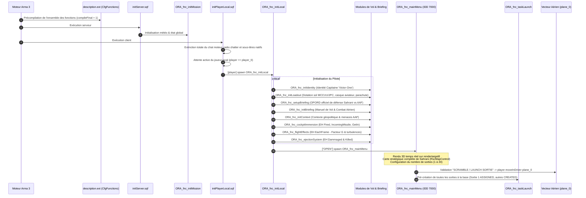

# ✈️ ORA - Air Force (Sahrani)
> Mission Solo Immersive pour Arma 3 — Spécifications Architecturales & Guide Technique

---

## 1. Vue d'Ensemble & Lore de la Mission

### A. Contexte Stratégique : La Bataille pour Sahrani
À l'aube, les **Forces Armées d'Altis (AAF)** ont déclenché une invasion militaire interarmées massive et sans préavis contre le territoire souverain du **Royaume de Sahrani**. Des chalands de débarquement et des forces d'assaut aéroportées ont forcé le cordon défensif maritime pour établir de solides têtes de pont sur les côtes Sud et Est.

Appuyées par des colonnes blindées lourdes (chars de combat MBT-52 Kuma, véhicules de combat d'infanterie AFV-4 Mora) et une couverture antiaérienne mobile (blindés bitubes Cheetah radar 35mm, équipes d'infanterie MANPADS Titan), les forces de l'AAF progressent vers l'intérieur pour couper l'archipel en deux et s'emparer des aérodromes stratégiques. Dans les cieux, des chasseurs d'attaque et des hélicoptères de combat contestent la supériorité aérienne.

### B. Rôle du Joueur & Factions
- **Faction Alliée :** **RACS** (*Royal Army Corps of Sahrani*) & Escadre Aérienne **ORA**.
- **Faction Ennemie :** **AAF** (*Altis Armed Forces*) — Force expéditionnaire d'invasion.
- **Entité Joueur :** `player_0` — Capitaine 'Victor-One', pilote de combat titulaire de l'ORA Air Force.
- **Vecteur Aérien Assigné :** `plane_0` — Chasseur polyvalent d'interception et d'attaque au sol (JAS-39 Gripen RACS).

#### Dotations Officielles des Unités (Source de Vérité : [`INFO_EDITOR.md`](INFO_EDITOR.md))
- **Unités Alliées au Sol (Infanterie RACS) :**
  - *Uniformes :* Treillis de combat MCCUU désert (`CUP_U_B_USMC_MCCUU_des*` - manches longues, retroussées, avec ou sans gants/genouillères).
  - *Gilets :* Gilets pare-balles tactiques JPC Coyote (`CUP_V_JPC_*_coy`).
  - *Casques :* Casques modernes Ops-Core Tan et Grey (`CUP_H_OpsCore_Tan*`, `CUP_H_OpsCore_Grey*`).
  - *Sacs à dos :* Sacs d'assaut et Kitbags Coyote (`CUP_B_AssaultPack_Coyote`, `B_assaultPack_cbr`, `B_Kitbag_cbr`).
  - *Optiques & Équipements :* Vision nocturne `NVGogglesB_blk_F`, jumelles et télémètres (`CUP_LRTV`, `CUP_Vector21Nite`, `CUP_SOFLAM`), foulards et lunettes balistiques, trousses médicales, grenades M67 et fumigènes de signalisation.
  - *Insigne Militaire :* Patch officiel du Royal Army Corps of Sahrani (`RACS_Badge`).
  - *Armes Principales :* Préservation des armements de dotation initiaux des escouades avec approvisionnement en chargeurs compatibles.
- **Pilote Joueur (`player_0`) :**
  - Dotation de combat au sol issue de `INFO_EDITOR.md` (treillis MCCUU désert, gilet tactique JPC Coyote, binos, JVN, fumigènes CSAR, trousses de secours, grenades M67 et patch RACS).
  - **Casque d'aviation de chasse exclusif :** `H_PilotHelmetFighter_I` (visière et masque à oxygène intégrés).
  - **Parachute dorsal de sauvetage obligatoire :** `B_Parachute` (en lieu et place des sacs d'infanterie).
  - **Arme de poing de survie en cabine :** Glock 17 (`CUP_hgun_Glock17`) avec chargeurs réservés dans le gilet.
  - **Lunettes de vol compatibles :** `G_Aviator` (exclusion des foulards intégraux et barbes afin d'éviter tout conflit de clipping supprimant le casque).
- **Unités Ennemies (AAF) :**
  - Les forces d'invasion de l'AAF conservent leurs équipements, blindés et camouflages numériques réglementaires.

### C. Directives Opérationnelles & Conditions d'Échec
1. **Protection des Troupes RACS au Sol :** Les garnisons territoriales du RACS luttent sous un feu nourri. Le joueur doit leur délivrer un appui aérien rapproché (CAS) chirurgical pour éviter l'anéantissement des avant-postes.
2. **Survie et Retour à la Base (RTB) :** Préserver l'appareil `plane_0` et atterrir intact en zone sécurisée.
3. **Préservation Maximale des Unités Alliées :** Accomplir les sorties avec aucune unité alliée tuée ou en veillant à la survie de l'écrasante majorité des forces amies.
4. **Série de Sorties Dynamiques :** Le joueur choisit au départ d'exécuter de façon exclusive **1 à 5**, **1 à 10**, **1 à 15** ou **1 à 20** missions réparties aléatoirement sur les secteurs tactiques de Sahrani.
5. **Règle Rouge - Intégrité du Cockpit (Condition de Défaite Absolue) :** L'abandon de l'appareil ou l'éjection en vol **n'est pas une option facultative**, mais une **condition d'échec immédiat et définitif** de la mission gérée par `ORA_fnc_cockpitEgressForfeit`. Tout abandon enclenche une alarme d'urgence, un message radio de détresse de la tour de contrôle et l'écran de défaite `EndCockpitForfeit`.

---

## 2. Documents de Référence & Sources de Vérité

Conformément aux normes du projet, ce document et ses fichiers satellites forment la hiérarchie officielle :

| Document | Rôle & Portée |
| :--- | :--- |
| **[`PROMPT.md`](PROMPT.md)** | Directives fondamentales, standards de codage SQF moderne, immersion et typage strict. |
| **[`INFO_EDITOR.md`](INFO_EDITOR.md)** | Registre contractuel des identifiants placés dans l'Éditeur Eden (`player_0`, `plane_0`, marqueurs) et dotation alliée au sol. |
| **[`INFO_ENNEMIS.md`](INFO_ENNEMIS.md)** | Registre des forces hostiles AAF (infanterie au sol, blindés, chars, navires, hélicoptères et avions de combat). |
| **[`INFO_TASKS.md`](INFO_TASKS.md)** | Règles fondamentales de codage des missions solo (anti-glitch Z+0.2, distances de sécurité, cycle de vie des tâches). |
| **[`INFO_TASK_DEV.md`](INFO_TASK_DEV.md)** | Spécifications d'ingénierie des 4 sorties dynamiques (Sol, Mer, Air, Héli), convergences alliées/ennemies et RTB. |
| **[`INFO_STRINTABLE.md`](INFO_STRINTABLE.md)** | Guide de localisation multilingue (15 langues supportées) et compilation non destructive. |
| **[`TTS.md`](TTS.md)** | Spécifications audio radio (modèle Kokoro TTS, filtres DSP, prononciation des coordonnées militaires). |
| **[`README.md`](README.md)** | **Architecture logicielle globale, flux d'exécution, catalogue de fonctions et interfaces GUI.** |

---

## 3. Arborescence Globale du Projet

```text
ORA.sara/
├── mission.sqm                    # Fichier de scène de l'Éditeur Eden (player_0, plane_0, terrain)
├── description.ext                # Configuration générale, CfgFunctions, CfgSounds, CfgDebriefing
├── initPlayerLocal.sqf            # Point d'entrée client (stabilisation et amorçage de player_0)
├── initServer.sqf                 # Point d'entrée serveur (initialisation de l'état global)
│
├── compile_stringtable.py         # Pipeline de compilation non destructive des clés XML (15 langues)
├── stringtable.xml                # Dictionnaire de localisation unifié généré automatiquement (147 clés)
│
├── INFO_EDITOR.md                 # Registre contractuel des entités Eden et dotation au sol RACS
├── INFO_ENNEMIS.md                # Registre des forces hostiles AAF (infanterie, blindés, air, mer)
├── INFO_TASKS.md                  # Règles fondamentales de codage des missions (Single-Player)
├── INFO_TASK_DEV.md               # Spécifications d'ingénierie des 4 sorties dynamiques et séquencement
├── INFO_STRINTABLE.md             # Guide de localisation et liste des 15 langues
├── PROMPT.md                      # Prompt maître et standards d'ingénierie SQF
├── README.md                      # Spécification architecturale du projet (ce fichier)
├── TTS.md                         # Architecture des messages radio et pipeline TTS
│
├── Dialogs/                       # ─── Définitions d'interfaces graphiques (GUI / HPP)
│   └── main_menu.hpp              # Panneau tactique de lancement (IDD 7000, carte, caméra 3D, options)
│
├── Images/                        # ─── Ressources graphiques et textures
│   └── racs_badge_ca.paa          # Insigne d'épaule officiel du Royal Army Corps of Sahrani
│
├── TTS/                           # ─── Outils et configurations audio de synthèse vocale
│   ├── config_tts.json            # Configuration du modèle vocal Kokoro et pipeline DSP radio
│   ├── generate_radio.py          # Script de génération audio avec traitement passe-bande et bruit HF
│   └── transcripts.json           # Registre des 20 messages radio du QG avec jargon et coordonnées
│
└── Functions/                     # ─── Bibliothèque modulaire CfgFunctions (Tag de préfixe: ORA)
    │
    ├── Briefing/                  # ─── Manuel de vol et renseignement tactique
    │   ├── fn_initBriefing.sqf    # Manuel de vol et combat aérien (Avionique, radar, brevity codes)
    │   ├── fn_initBriefing.xml    # Clés multilingues du manuel de vol
    │   ├── fn_initContext.sqf     # Contexte géopolitique, ordre de bataille AAF et défenses RACS
    │   └── fn_initContext.xml     # Clés de l'onglet tactique "Context"
    │
    ├── Core/                      # ─── Noyau système, logique serveur et transmissions
    │   ├── fn_initMission.sqf     # Initialisation de l'environnement serveur et météo
    │   ├── fn_radioMsg.sqf        # Moteur de transmissions radio diégétiques & sous-titres HUD
    │   └── fn_radioMsg.xml        # Clés de dialogue et codes radio multi-langues
    │
    ├── Environment/               # ─── Météo dynamique et gestion des unités de combat
    │   ├── fn_randomWeather.sqf   # Météo dynamique avancée adaptée aux opérations aéronautiques
    │   ├── fn_initSkills.sqf      # Équilibrage des compétences événementiel (EntityCreated, zéro polling)
    │   ├── fn_applyRACSLoadout.sqf# Dotation officielle RACS (INFO_EDITOR.md) pour les unités indépendantes
    │   ├── fn_applyRACSLoadout.xml# Clés de désignation de la dotation RACS
    │   └── fn_preventWater.sqf    # Sécurisation côtière anti-noyade (infanterie au sol à pied exclusivement)
    │
    ├── Flight/                    # ─── Dynamique de vol, ravitaillement, armement & pannes
    │   ├── fn_flightEffects.sqf   # Facteurs de charge (G), secousses transsoniques & turbulences (EachFrame)
    │   ├── fn_flightEffects.xml   # Clés de retours de vol
    │   ├── fn_ejectionSystem.sqf  # Surveillance des avaries critiques, alarme éjection et CSAR
    │   ├── fn_ejectionSystem.xml  # Alertes avarie moteur et messages de détresse
    │   ├── fn_cockpitEgressForfeit.sqf # Surveillance impérative d'abandon du cockpit (condition de défaite)
    │   ├── fn_cockpitEgressForfeit.xml # Clés et débriefing d'échec par abandon de poste
    │   ├── fn_weaponGuidance.sqf  # Assistance de tir optimale : PN Lead Pursuit + fusée de proximité radar
    │   ├── fn_weaponGuidance.xml  # Clés multilingues du système de guidage d'armement
    │   ├── fn_airRefuel.sqf       # Ravitailleur C-130J en vol perpétuel avec détection de ravitaillement à 200m
    │   ├── fn_airRefuel.xml       # Clés multilingues du système de ravitaillement
    │   └── fn_callTanker.sqf      # Menu radio 0-8-1 : vecteur direct du ravitailleur vers le joueur (sécurité 1km/500m)
    │
    ├── Player/                    # ─── Expérience pilote, dotation et immersion cockpit
    │   ├── fn_initLocal.sqf       # Orchestrateur client unifié (liaison des sous-systèmes, extinction chat/radio)
    │   ├── fn_initLocal.xml       # Clés du client local
    │   ├── fn_initIdentity.sqf    # Identité militaire (Capitaine 'Victor-One', voix anglaise)
    │   ├── fn_initIdentity.xml    # Clés de désignation d'identité
    │   ├── fn_initLoadout.sqf     # Dotation pilote (base MCCUU/JPC au sol, casque aviateur, parachute dorsal)
    │   ├── fn_initLoadout.xml     # Clés de notification d'équipement
    │   ├── fn_setupBriefing.sqf   # Génération de l'OPORD natif (défense de Sahrani vs AAF)
    │   ├── fn_setupBriefing.xml   # Textes du briefing natif (Situation, Mission, ROE, Radio)
    │   ├── fn_cockpitImmersion.sqf# Écouteurs cockpit natifs (Fired, IncomingMissile, GetIn)
    │   └── fn_cockpitImmersion.xml# Alertes RWR et statuts cockpit
    │
    ├── Task/                      # ─── Génération, nettoyage et supervision des sorties
    │   ├── fn_taskLaunch.sqf      # Pré-création de l'arborescence des sorties à la base, séquencement & RTB
    │   ├── fn_taskLaunch.xml      # Clés multilingues des sorties, sous-tâches d'objectifs et RTB
    │   ├── fn_taskGround.sqf      # Frappe au sol (routes marker_blue_0..52 -> embuscade alliée >950m)
    │   ├── fn_taskGround.xml      # Clés et ordres radio de frappe terrestre
    │   ├── fn_taskSea.sqf         # Frappe navale (patrouille circuit strict marker_blue_0..39 sans inversion)
    │   ├── fn_taskSea.xml         # Clés et ordres radio de frappe navale
    │   ├── fn_taskAir.sqf         # Interception aérienne (spawns lointains marker_red_0..7)
    │   ├── fn_taskAir.xml         # Clés et ordres radio d'interception
    │   ├── fn_taskHeli.sqf        # Chasse hélicoptères (spawns marker_orange_0..52 engagés contre troupes au sol)
    │   ├── fn_taskHeli.xml        # Clés et ordres radio de frappe anti-hélicoptère
    │   └── fn_taskCleanup.sqf     # Nettoyage automatique des unités des tâches terminées (>2 000 m du joueur)
    │
    └── UI/                        # ─── Interfaces graphiques et menus de mission
        ├── fn_mainMenu.sqf        # Panneau de lancement (objectifs RACS, choix sorties, carte et météo)
        └── fn_mainMenu.xml        # Clés d'interface du menu principal
```

---

## 4. Cycle de Vie et Flux d'Exécution (Runtime Flow)

Le cycle d'exécution respecte scrupuleusement la séparation Client/Serveur, l'amorçage asynchrone et l'ordre d'initialisation du moteur Real Virtuality :



---

## 5. Panneau Tactique de Lancement (`Dialogs\main_menu.hpp` / `fn_mainMenu.sqf`)

Le menu d'accueil (IDD `7000`) s'affiche dès l'entrée en jeu en fond d'écran flouté et offre une préparation opérationnelle immersive :

1. **Objectifs Principaux RACS (Rappel permanent) :**
   - Protéger les unités RACS alliées au sol.
   - Revenir en vie avec l'appareil (RTB).
   - Veiller à ce qu'aucune unité amie ne meure (ou que la majorité des unités restent en vie).
2. **Sélection Exclusive du Nombre de Missions :**
   - Un groupe de boutons radio exclusifs permet au pilote de sélectionner la durée de son engagement :
     * **1 à 5 missions**
     * **1 à 10 missions**
     * **1 à 15 missions**
     * **1 à 20 missions**
3. **Options Tactiques Libres :**
   - **Aide au tir / Téléguidage (`CB_OptGuidance`, IDC 7120) :** Système haute performance de guidage vectoriel (`ORA_fnc_weaponGuidance`). Navigation proportionnelle prédictive (*Lead Intercept*) et fusée de proximité radar ($< 7.5\text{m}$ air / $< 4\text{m}$ sol-mer).
   - **Autres présences alliées (`CB_OptAllies`, IDC 7121) :** Renforts et patrouilles d'escorte RACS au sol et dans l'espace aérien.
   - **Bannière d'Alerte Rouge - Condition de Défaite Impérative :** Encart d'avertissement non sélectionnable (sans case à cocher) stipulant clairement que *l'extraction ou l'éjection du cockpit fait perdre immédiatement la mission*.
   - **Directives de Vol & Support Ravitailleur :** Rappel de la disponibilité du support radio `0-8-1` pour appeler le C-130J en cas de besoin, avec guidage sans collision et alertes de maintien de cap à 1 000 m et 500 m.
4. **Grande Carte Tactique de Sahrani :**
   - Intègre un contrôle cartographique grand format (`RscMapControl`) calibré pour afficher la topographie et la couverture satellite de l'archipel sans écran noir, avec intégration des sous-classes d'infrastructures énergétiques (`powersolar`, `power`, `powerwind`, `powerwave`, `Shipwreck`) évitant toute erreur de configuration.
5. **Prévisualisation 3D Temps Réel de l'Appareil :**
   - Une caméra cinématique capture `plane_0` sur le tarmac et projette le flux vidéo en direct sur `rendertarget8` via un contrôle picture `#(argb,512,512,1)r2t(rendertarget8,1.0)`.
6. **Insertion Directe Cockpit :**
   - La validation du bouton « SCRAMBLE / LAUNCH SORTIE » détruit la caméra, ferme l'interface et installe immédiatement le pilote dans le siège conducteur (`player moveInDriver plane_0`).

---

## 6. Catalogue des Modules et Fonctions

Toutes les fonctions sont déclarées sous le tag **`ORA`** dans le [`description.ext`](description.ext) et précompilées avec l'attribut `compileFinal = 1;`.

### A. Catégorie `Core` (`Functions\Core\`)
| Fonction | Fichier source | Rôle & Paramètres | Déclenchement |
| :--- | :--- | :--- | :--- |
| `ORA_fnc_initMission` | [`fn_initMission.sqf`](Functions/Core/fn_initMission.sqf) | Initialise les variables globales de mission et l'environnement serveur.<br/>*Sans arguments.* | Appelé par `initServer.sqf`. |
| `ORA_fnc_radioMsg` | [`fn_radioMsg.sqf`](Functions/Core/fn_radioMsg.sqf) | Affiche un message radio stylisé avec indicatif, couleur tactique et son natif (0 chat, 0 log).<br/>*Params : `[_sender, _message, _sound]`* | À la demande (système, ATC, AWACS). |

### B. Catégorie `Flight` (`Functions\Flight\`)
| Fonction | Fichier source | Rôle & Paramètres | Déclenchement |
| :--- | :--- | :--- | :--- |
| `ORA_fnc_flightEffects` | [`fn_flightEffects.sqf`](Functions/Flight/fn_flightEffects.sqf) | Calcule les accélérations différentielles (G-Force) et turbulences de relief via `EachFrame`.<br/>*Params : `[_pilot, _plane]`* | Appelé par `ORA_fnc_initLocal`. |
| `ORA_fnc_ejectionSystem` | [`fn_ejectionSystem.sqf`](Functions/Flight/fn_ejectionSystem.sqf) | Installe les Event Handlers `Dammaged` et `Killed` sur `plane_0` et `player_0`.<br/>*Params : `[_pilot, _plane]`* | Appelé par `ORA_fnc_initLocal`. |
| `ORA_fnc_cockpitEgressForfeit` | [`fn_cockpitEgressForfeit.sqf`](Functions/Flight/fn_cockpitEgressForfeit.sqf) | Surveille les écouteurs `GetOutMan` et `GetOut` : toute éjection ou sortie du cockpit de `plane_0` déclenche immédiatement l'échec de la mission (`EndCockpitForfeit`).<br/>*Params : `[_pilot, _plane]`* | Appelé au lancement de la sortie dans `ORA_fnc_mainMenu`. |
| `ORA_fnc_weaponGuidance` | [`fn_weaponGuidance.sqf`](Functions/Flight/fn_weaponGuidance.sqf) | Assistance au tir optimisée : séparation balistique 0.35s sous voilure, navigation proportionnelle (*PN Lead Pursuit*), taux de virage progressif aérodynamique (0.12 à 0.38), fusée de proximité radar terminale (<7.5m air, <4m sol/mer) et trajectoire balistique stabilisée si cible perdue.<br/>*Params : `[_plane, _enable]`* | Appelé au lancement dans `ORA_fnc_mainMenu` si l'option IDC 7120 est active. |
| `ORA_fnc_airRefuel` | [`fn_airRefuel.sqf`](Functions/Flight/fn_airRefuel.sqf) | Gestionnaire de l'avion ravitailleur C-130J : vol en orbite à 2 000 m, invulnérable, invisible pour les ennemis, ravitaillement automatique (carburant, intégrité, munitions 100%) à moins de 200 m.<br/>*Params : `[_orbitCenter, _altitude, _radius]`* | Appelé au lancement serveur dans `ORA_fnc_initMission`. |
| `ORA_fnc_callTanker` | [`fn_callTanker.sqf`](Functions/Flight/fn_callTanker.sqf) | Menu de support radio 0-8-1 : vecteur direct du C-130J vers la position du joueur avec maintien d'altitude de sécurité, avertissements à 1 000 m et 500 m, et retour automatique en orbite après ravitaillement.<br/>*Sans arguments.* | Appelé via le menu de communications (0-8-1). |

### C. Catégorie `Player` (`Functions\Player\`)
| Fonction | Fichier source | Rôle & Paramètres | Déclenchement |
| :--- | :--- | :--- | :--- |
| `ORA_fnc_initLocal` | [`fn_initLocal.sqf`](Functions/Player/fn_initLocal.sqf) | Orchestrateur client unifié : désactive les canaux radio/chat moteurs, vérifie la conformité avec `INFO_EDITOR.md` et lie tous les sous-systèmes.<br/>*Params : `[_unit]`* | Appelé par `initPlayerLocal.sqf`. |
| `ORA_fnc_setupBriefing` | [`fn_setupBriefing.sqf`](Functions/Player/fn_setupBriefing.sqf) | Génère les sections officielles du journal de bord (OPORD de défense du territoire de Sahrani contre l'invasion AAF, directives, règles d'engagement et signaux).<br/>*Sans arguments.* | Appelé par `ORA_fnc_initLocal`. |
| `ORA_fnc_cockpitImmersion` | [`fn_cockpitImmersion.sqf`](Functions/Player/fn_cockpitImmersion.sqf) | Attache les écouteurs de tir (`Fired`), alerte missile entrant (`IncomingMissile`) et embarquement (`GetInMan`).<br/>*Params : `[_pilot, _plane]`* | Appelé par `ORA_fnc_initLocal`. |
| `ORA_fnc_initLoadout` | [`fn_initLoadout.sqf`](Functions/Player/fn_initLoadout.sqf) | Équipe le pilote de chasse : dotation de combat des unités terrestres RACS (treillis MCCUU désert, gilet JPC Coyote, Glock 17, binos, JVN, fumigènes CSAR, patch RACS) combinée au casque d'aviation de chasse (`H_PilotHelmetFighter_I`) et au parachute dorsal de sauvetage (`B_Parachute`).<br/>*Params : `[_pilot]`* | Appelé par `ORA_fnc_initLocal`. |
| `ORA_fnc_applyLoadout` | [`fn_applyLoadout.sqf`](Functions/Player/fn_applyLoadout.sqf) | Interface modulaire d'application de chargement pilote.<br/>*Params : `[_unit]`* | Modulaire. |
| `ORA_fnc_initIdentity` | [`fn_initIdentity.sqf`](Functions/Player/fn_initIdentity.sqf) | Configure l'identité militaire du pilote (Capitaine 'Victor-One', voix radio anglophone).<br/>*Params : `[_pilot]`* | Appelé par `ORA_fnc_initLocal`. |

### D. Catégorie `Briefing` (`Functions\Briefing\`)
| Fonction | Fichier source | Rôle & Paramètres | Déclenchement |
| :--- | :--- | :--- | :--- |
| `ORA_fnc_initBriefing` | [`fn_initBriefing.sqf`](Functions/Briefing/fn_initBriefing.sqf) | Génère le Manuel de Vol et Combat Aérien (Avionique, radar, brevity codes, G-forces, éjection).<br/>*Sans arguments.* | Appelé par `ORA_fnc_initLocal`. |
| `ORA_fnc_initContext` | [`fn_initContext.sqf`](Functions/Briefing/fn_initContext.sqf) | Renseigne le contexte géopolitique (campagne de Sahrani face à l'invasion AAF), l'ordre de bataille adverse et le dispositif défensif RACS.<br/>*Sans arguments.* | Appelé par `ORA_fnc_initLocal`. |

### E. Catégorie `Environment` (`Functions\Environment\`)
| Fonction | Fichier source | Rôle & Paramètres | Déclenchement |
| :--- | :--- | :--- | :--- |
| `ORA_fnc_randomWeather` | [`fn_randomWeather.sqf`](Functions/Environment/fn_randomWeather.sqf) | Météo dynamique avancée adaptée aux opérations aéronautiques.<br/>*Sans arguments.* | Serveur. |
| `ORA_fnc_initSkills` | [`fn_initSkills.sqf`](Functions/Environment/fn_initSkills.sqf) | Équilibre les compétences des alliés RACS et des menaces antiaériennes (zéro polling via `EntityCreated`).<br/>*Params : `[_targetUnit]`* | Appelé par `ORA_fnc_initMission`. |
| `ORA_fnc_applyRACSLoadout` | [`fn_applyRACSLoadout.sqf`](Functions/Environment/fn_applyRACSLoadout.sqf) | Équipe les troupes indépendantes (RACS) selon la dotation de `INFO_EDITOR.md` (JPC, Ops-Core, MCCUU, JVN, fumigènes, badge RACS), exclut le joueur pilote et installe l'écouteur `EntityCreated`.<br/>*Params : `[_targetUnit]`* | Appelé par `ORA_fnc_initMission`. |
| `ORA_fnc_preventWater` | [`fn_preventWater.sqf`](Functions/Environment/fn_preventWater.sqf) | Contrôle et sécurisation anti-noyade réservée exclusivement à l'infanterie au sol à pied (exclut équipages navals/véhicules et pilotes).<br/>*Sans arguments.* | Appelé par `ORA_fnc_initMission`. |

### F. Catégorie `UI` (`Functions\UI\`)
| Fonction | Fichier source | Rôle & Paramètres | Déclenchement |
| :--- | :--- | :--- | :--- |
| `ORA_fnc_mainMenu` | [`fn_mainMenu.sqf`](Functions/UI/fn_mainMenu.sqf) | Panneau de lancement tactique (objectifs RACS, choix sorties 1-20, options de vol, grande carte et insertion cockpit).<br/>*Params : `[_mode, _args]`* | Appelé par `ORA_fnc_initLocal`. |

### G. Catégorie `Task` (`Functions\Task\`)
| Fonction | Fichier source | Rôle & Paramètres | Déclenchement |
| :--- | :--- | :--- | :--- |
| `ORA_fnc_taskLaunch` | [`fn_taskLaunch.sqf`](Functions/Task/fn_taskLaunch.sqf) | Orchestrateur maître des sorties : pré-crée l'ensemble de l'arborescence des tâches à la base (Sortie 1 ASSIGNED, sorties suivantes et RTB CREATED), assure le suivi séquentiel multi-objectifs, et déclenche le RTB final.<br/>*Params : `[_taskType, _totalSorties]`* | Lancé après insertion cockpit dans `ORA_fnc_mainMenu`. |
| `ORA_fnc_taskGround` | [`fn_taskGround.sqf`](Functions/Task/fn_taskGround.sqf) | Frappe au sol (CAS) : cibles positionnées exactement sur le réseau routier (`marker_blue_0` à `marker_blue_52`), en déplacement vers un point d'embuscade allié à plus de 950 m où des troupes RACS armées les attendent. Sous-tâches individuelles si $\ge 2$ cibles.<br/>*Params : `[_taskID, _orderNum]`* | Appelé par `ORA_fnc_taskLaunch`. |
| `ORA_fnc_taskSea` | [`fn_taskSea.sqf`](Functions/Task/fn_taskSea.sqf) | Frappe navale en haute mer : circuit maritime strictement ordonné suivant la suite ascendante des marqueurs `marker_blue_0` à `marker_blue_39` en boucle perpétuelle sans demi-tour ni échouement. Alignement des vedettes en colonne à 45m. Sous-tâches si $\ge 2$ navires.<br/>*Params : `[_taskID, _orderNum]`* | Appelé par `ORA_fnc_taskLaunch`. |
| `ORA_fnc_taskAir` | [`fn_taskAir.sqf`](Functions/Task/fn_taskAir.sqf) | Interception aérienne : apparition des chasseurs ennemis hors de l'espace aérien national sur les marqueurs `marker_red_0` à `marker_red_7`, en pénétration haute altitude. Sous-tâches individuelles si $\ge 2$ appareils.<br/>*Params : `[_taskID, _orderNum]`* | Appelé par `ORA_fnc_taskLaunch`. |
| `ORA_fnc_taskHeli` | [`fn_taskHeli.sqf`](Functions/Task/fn_taskHeli.sqf) | Chasse hélicoptères : apparition sur les marqueurs `marker_orange_0` à `marker_orange_52` en vol tactique basse altitude, engagés contre des détachements alliés au sol. Sous-tâches individuelles si $\ge 2$ hélicos.<br/>*Params : `[_taskID, _orderNum]`* | Appelé par `ORA_fnc_taskLaunch`. |
| `ORA_fnc_taskCleanup` | [`fn_taskCleanup.sqf`](Functions/Task/fn_taskCleanup.sqf) | Gestionnaire de nettoyage du théâtre d'opérations : après achèvement d'une sortie, supprime immédiatement les unités de la tâche situées à plus de 2 000 m du joueur, et met en veille les unités restantes jusqu'à ce que le joueur s'éloigne au-delà de 2 000 m.<br/>*Params : `[_units, _vehicles]`* | Appelé à la fin de chaque sortie. |

---

## 7. Système de Localisation Multi-Langues (15 Langues)

Chaque module affichant du texte en jeu s'accompagne d'un fichier XML jumeau (ex: `fn_mainMenu.sqf` ↔ `fn_mainMenu.xml`).
La compilation est assurée par le script autonome [`compile_stringtable.py`](compile_stringtable.py) qui consolide **147 clés actives** couvrant les briefings, l'avionique, le panneau de commandement, l'assistance de tir, le ravitailleur C-130J, les sous-tâches d'objectifs et les 4 types de sorties opérationnelles :

```bash
python compile_stringtable.py
```

### Langues Supportées dans `stringtable.xml` :
1. **Original / English** (Langue de référence de l'architecture)
2. **French** (Français)
3. **Spanish** (Español)
4. **German** (Deutsch)
5. **Italian** (Italiano)
6. **Polish** (Polski)
7. **Portuguese** (Português)
8. **Russian** (Русский)
9. **Czech** (Čeština)
10. **Korean** (한국어)
11. **Japanese** (日本語)
12. **Chinese** (繁體中文)
13. **Chinesesimp** (简体中文)
14. **Turkish** (Türkçe)

---

## 8. Pipeline Audio Radio & Synthèse Vocale (TTS)

Pour garantir une immersion de haut niveau lors des ordres transmis par le QG en vol :
- **Générateur Audio :** [`TTS/generate_radio.py`](TTS/generate_radio.py) alimenté par le modèle Kokoro TTS.
- **Traitement DSP Militaire :** Filtrage passe-bande radio (300 Hz - 3400 Hz), compression dynamique, saturation analogique et bruit de fond HF avec beeps de transmission.
- **Formatage des Coordonnées Grilles :** Les ordres de mission dictent les positions militaires en séparant distinctement chaque chiffre (`1.1.2.3 2.6.6.7`) pour une phonétique radio claire et réaliste.
- Référence complète : [`TTS.md`](TTS.md).

---

## 9. Standards d'Ingénierie & Silence Moteur

1. **Aucun Polling Infini (`while {true}`) :**
   Tous les mécanismes sont pilotés par des événements du moteur (`EachFrame`, `EntityCreated`, `Fired`, `IncomingMissile`, `Dammaged`, `Killed`, `GetInMan`).
2. **Silence Absolu des Canaux et Logs Moteurs :**
   - Extinction complète du chat en jeu (`showChat false`, `enableRadio false`, `enableSentences false`, `0 fadeRadio 0`).
   - Désactivation intégrale des canaux de communication (`disableChannels[]` dans `description.ext`).
   - Suppression totale des appels de diagnostic (`diag_log`) et des messages système génériques (`systemChat`).
3. **Typage Strict et Isolation :**
   Toutes les fonctions utilisent `params` avec typage et valeurs par défaut. Les variables temporaires sont strictement privatisées (`private _var`).
4. **Programmation Défensive & Anti-Glitch :**
   Vérification systématique de l'existence des objets (`isNull`, `alive`) avec sortie anticipée (`exitWith`), et élévation $Z + 0.2\text{ m}$ à l'apparition pour éviter toute collision géométrique avec le terrain.
5. **Localisation Universelle :**
   Aucun message, étiquette UI ou titre n'est hardcodé. Utilisation exclusive de `localize "STR_..."`.
