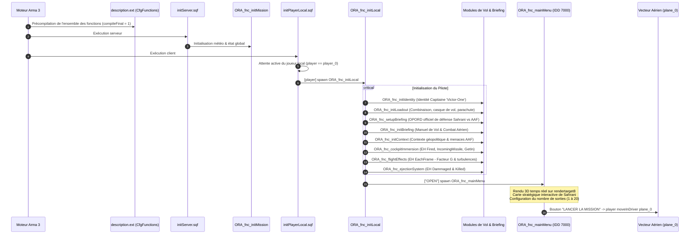

# ✈️ ORA - Air Force (Sahrani)
> Mission Solo Immersive pour Arma 3 — Spécifications Architecturales & Guide Technique

---

## 1. Vue d'Ensemble & Lore de la Mission

### A. Contexte Stratégique : La Bataille pour Sahrani
À l'aube, les **Forces Armées d'Altis (AAF)** ont déclenché une invasion militaire interarmées massive et sans préavis contre le territoire souverain du **Royaume de Sahrani**. Des chalands de débarquement et des forces d'assaut aéroportées ont forcé le cordon défensif maritime pour établir de solides têtes de pont sur les côtes Sud et Est.

Appuyées par des colonnes blindées lourdes (chars de combat MBT-52 Kuma, véhicules de combat d'infanterie AFV-4 Mora) et une couverture antiaérienne mobile (blindés bitubes Cheetah radar 35mm, équipes d'infanterie MANPADS Titan), les forces de l'AAF progressent vers l'intérieur pour couper l'archipel en deux et s'emparer des aérodromes stratégiques. Dans les cieux, des chasseurs d'attaque A-143 Buzzard et des hélicoptères de combat WY-55 Hellcat contestent la supériorité aérienne.

### B. Rôle du Joueur & Factions
- **Faction Alliée :** **RACS** (*Royal Army Corps of Sahrani*) & Escadre Aérienne **ORA**.
- **Faction Ennemie :** **AAF** (*Altis Armed Forces*) — Force expéditionnaire d'invasion.
- **Entité Joueur :** `player_0` — Capitaine 'Victor-One', pilote de combat titulaire de l'ORA Air Force.
- **Vecteur Aérien Assigné :** `plane_0` — Chasseur polyvalent d'interception et d'attaque au sol.

### C. Directives Opérationnelles & Conditions d'Échec
1. **Protection des Troupes RACS au Sol :** Les garnisons territoriales du RACS luttent sous un feu nourri. Le joueur doit leur délivrer un appui aérien rapproché (CAS) chirurgical pour éviter l'anéantissement des avant-postes.
2. **Survie et Retour à la Base (RTB) :** Préserver l'appareil `plane_0` et atterrir intact en zone sécurisée.
3. **Préservation Maximale des Unités Alliées :** Accomplir les sorties avec aucune unité alliée tuée ou en veillant à la survie de l'écrasante majorité des forces amies.
4. **Série de Sorties Dynamiques :** Le joueur choisit au départ d'exécuter de façon exclusive **1 à 5**, **1 à 10**, **1 à 15** ou **1 à 20** missions réparties aléatoirement sur les secteurs tactiques de Sahrani.
5. **Règle Rouge - Intégrité du Cockpit :** L'abandon de l'appareil ou l'éjection en vol entraîne **l'échec immédiat et définitif de la mission**. Le pilote doit impérativement ramener son appareil.

---

## 2. Documents de Référence & Sources de Vérité

Conformément aux normes du projet, ce document et ses fichiers satellites forment la hiérarchie officielle :

| Document | Rôle & Portée |
| :--- | :--- |
| **[`PROMPT.md`](PROMPT.md)** | Directives fondamentales, standards de codage SQF moderne, immersion et typage strict. |
| **[`INFO_EDITOR.md`](INFO_EDITOR.md)** | Registre contractuel des identifiants placés dans l'Éditeur Eden (`player_0`, `plane_0`, marqueurs). |
| **[`INFO_STRINTABLE.md`](INFO_STRINTABLE.md)** | Guide de localisation multilingue (15 langues supportées) et compilation non destructive. |
| **[`TTS.md`](TTS.md)** | Spécifications audio radio (modèle Kokoro TTS, filtres DSP, prononciation des coordonnées militaires). |
| **[`README.md`](README.md)** | **Architecture logicielle globale, flux d'exécution, catalogue de fonctions et interfaces GUI.** |

---

## 3. Arborescence Globale du Projet

```text
ORA.sara/
├── mission.sqm                    # Fichier de scène de l'Éditeur Eden (player_0, plane_0, terrain)
├── description.ext                # Configuration générale, CfgFunctions, CfgSounds, CfgDebriefing
├── initPlayerLocal.sqf            # Point d'entrée client (stabilisation et amorçage de player_0)
├── initServer.sqf                 # Point d'entrée serveur (initialisation de l'état global)
│
├── compile_stringtable.py         # Pipeline de compilation non destructive des clés XML (15 langues)
├── stringtable.xml                # Dictionnaire de localisation unifié généré automatiquement
│
├── INFO_EDITOR.md                 # Registre contractuel des entités de l'éditeur Eden
├── INFO_STRINTABLE.md             # Guide de localisation et liste des 15 langues
├── PROMPT.md                      # Prompt maître et standards d'ingénierie SQF
├── README.md                      # Spécification architecturale du projet (ce fichier)
├── TTS.md                         # Architecture des messages radio et pipeline TTS
│
├── Dialogs/                       # ─── Définitions d'interfaces graphiques (GUI / HPP)
│   └── main_menu.hpp              # Panneau tactique de lancement (IDD 7000, carte, caméra 3D, options)
│
├── Images/                        # ─── Ressources graphiques et textures
│   └── racs_badge_ca.paa          # Insigne d'épaule officiel du Royal Army Corps of Sahrani
│
├── TTS/                           # ─── Outils et configurations audio de synthèse vocale
│   ├── config_tts.json            # Configuration du modèle vocal Kokoro et pipeline DSP radio
│   ├── generate_radio.py          # Script de génération audio avec traitement passe-bande et bruit HF
│   └── transcripts.json           # Registre des 20 messages radio du QG avec jargon et coordonnées
│
└── Functions/                     # ─── Bibliothèque modulaire CfgFunctions (Tag de préfixe: ORA)
    │
    ├── Briefing/                  # ─── Manuel de vol et renseignement tactique
    │   ├── fn_initBriefing.sqf    # Manuel de vol et combat aérien (Avionique, radar, brevity codes)
    │   ├── fn_initBriefing.xml    # Clés multilingues du manuel de vol
    │   ├── fn_initContext.sqf     # Contexte géopolitique, ordre de bataille AAF et défenses RACS
    │   └── fn_initContext.xml     # Clés de l'onglet tactique "Context"
    │
    ├── Core/                      # ─── Noyau système, logique serveur et transmissions
    │   ├── fn_initMission.sqf     # Initialisation de l'environnement serveur et météo
    │   ├── fn_radioMsg.sqf        # Moteur de transmissions radio diégétiques & sous-titres HUD
    │   └── fn_radioMsg.xml        # Clés de dialogue et codes radio multi-langues
    │
    ├── Environment/               # ─── Météo dynamique et équilibrage des unités
    │   ├── fn_randomWeather.sqf   # Météo dynamique avancée adaptée aux opérations aéronautiques
    │   └── fn_initSkills.sqf      # Équilibrage des compétences événementiel (EntityCreated, zéro polling)
    │
    ├── Flight/                    # ─── Dynamique de vol, modèle sensoriel & gestion des pannes
    │   ├── fn_flightEffects.sqf   # Facteurs de charge (G), secousses transsoniques & turbulences (EachFrame)
    │   ├── fn_flightEffects.xml   # Clés de retours de vol
    │   ├── fn_ejectionSystem.sqf  # Surveillance des avaries critiques, alarme éjection et CSAR
    │   └── fn_ejectionSystem.xml  # Alertes avarie moteur et messages de détresse
    │
    ├── Player/                    # ─── Expérience pilote, dotation et immersion cockpit
    │   ├── fn_initLocal.sqf       # Orchestrateur client unifié (liaison des sous-systèmes)
    │   ├── fn_initLocal.xml       # Clés du client local
    │   ├── fn_initIdentity.sqf    # Identité militaire (Capitaine 'Victor-One', voix anglaise)
    │   ├── fn_initIdentity.xml    # Clés de désignation d'identité
    │   ├── fn_initLoadout.sqf     # Dotation pilote (casque de vol, combinaison ignifugée, parachute)
    │   ├── fn_initLoadout.xml     # Clés de notification d'équipement
    │   ├── fn_setupBriefing.sqf   # Génération de l'OPORD natif (défense de Sahrani vs AAF)
    │   ├── fn_setupBriefing.xml   # Textes du briefing natif (Situation, Mission, ROE, Radio)
    │   ├── fn_cockpitImmersion.sqf# Écouteurs cockpit natifs (Fired, IncomingMissile, GetIn)
    │   └── fn_cockpitImmersion.xml# Alertes RWR et statuts cockpit
    │
    └── UI/                        # ─── Interfaces graphiques et menus de mission
        ├── fn_mainMenu.sqf        # Panneau de lancement (objectifs RACS, choix 1-20 sorties, carte)
        └── fn_mainMenu.xml        # Clés d'interface du menu principal
```

---

## 4. Cycle de Vie et Flux d'Exécution (Runtime Flow)

Le cycle d'exécution respecte scrupuleusement la séparation Client/Serveur, l'amorçage asynchrone et l'ordre d'initialisation du moteur Real Virtuality :



---

## 5. Panneau Tactique de Lancement (`Dialogs\main_menu.hpp` / `fn_mainMenu.sqf`)

Le menu d'accueil (IDD `7000`) s'affiche dès l'entrée en jeu en fond d'écran flouté et offre une préparation opérationnelle immersive :

1. **Objectifs Principaux RACS (Rappel permanent) :**
   - Protéger les unités RACS au sol.
   - Revenir en vie avec l'appareil.
   - Veiller à ce qu'aucune unité ne meure (ou que la majorité des unités restent en vie).
2. **Sélection Exclusive du Nombre de Missions :**
   - Un groupe de boutons radio exclusifs permet au pilote de sélectionner la durée de son engagement :
     * **1 à 5 missions**
     * **1 à 10 missions**
     * **1 à 15 missions**
     * **1 à 20 missions**
3. **Options Tactiques Libres :**
   - **Téléguidage des tirs** (aide à l'acquisition et conduite de tir).
   - **Autres présences alliées** (renforts et patrouilles d'escorte RACS).
   - **Alerte Rouge - Abandon Interdit :** Affiche clairement l'avertissement stylisé en rouge stipulant que *l'extraction ou l'éjection du cockpit fait perdre la mission*.
4. **Grande Carte Tactique de Sahrani :**
   - Intègre un contrôle cartographique grand format (`RscMapControl`) permettant de visualiser l'archipel de Sahrani, la topographie et les secteurs d'opérations.
5. **Prévisualisation 3D Temps Réel de l'Appareil :**
   - Une caméra cinématique capture `plane_0` sur le tarmac et projette le flux vidéo en direct sur `rendertarget8` via un contrôle picture `#(argb,512,512,1)r2t(rendertarget8,1.0)`.
6. **Insertion Directe Cockpit :**
   - La validation du bouton « LANCER LA MISSION » détruit la caméra, ferme l'interface et installe immédiatement le pilote dans le siège conducteur (`player moveInDriver plane_0`).

---

## 6. Catalogue des Modules et Fonctions

Toutes les fonctions sont déclarées sous le tag **`ORA`** dans le [`description.ext`](description.ext) et précompilées avec l'attribut `compileFinal = 1;`.

### A. Catégorie `Core` (`Functions\Core\`)
| Fonction | Fichier source | Rôle & Paramètres | Déclenchement |
| :--- | :--- | :--- | :--- |
| `ORA_fnc_initMission` | [`fn_initMission.sqf`](Functions/Core/fn_initMission.sqf) | Initialise les variables globales de mission et l'environnement serveur.<br/>*Sans arguments.* | Appelé par `initServer.sqf`. |
| `ORA_fnc_radioMsg` | [`fn_radioMsg.sqf`](Functions/Core/fn_radioMsg.sqf) | Affiche un message radio stylisé avec indicatif, couleur tactique et son.<br/>*Params : `[_sender, _message, _sound]`* | À la demande (système, ATC, AWACS). |

### B. Catégorie `Flight` (`Functions\Flight\`)
| Fonction | Fichier source | Rôle & Paramètres | Déclenchement |
| :--- | :--- | :--- | :--- |
| `ORA_fnc_flightEffects` | [`fn_flightEffects.sqf`](Functions/Flight/fn_flightEffects.sqf) | Calcule les accélérations différentielles (G-Force) et turbulences de relief via `EachFrame`.<br/>*Params : `[_pilot, _plane]`* | Appelé par `ORA_fnc_initLocal`. |
| `ORA_fnc_ejectionSystem` | [`fn_ejectionSystem.sqf`](Functions/Flight/fn_ejectionSystem.sqf) | Installe les Event Handlers `Dammaged` et `Killed` sur `plane_0` et `player_0`.<br/>*Params : `[_pilot, _plane]`* | Appelé par `ORA_fnc_initLocal`. |

### C. Catégorie `Player` (`Functions\Player\`)
| Fonction | Fichier source | Rôle & Paramètres | Déclenchement |
| :--- | :--- | :--- | :--- |
| `ORA_fnc_initLocal` | [`fn_initLocal.sqf`](Functions/Player/fn_initLocal.sqf) | Orchestrateur client : vérifie la conformité avec `INFO_EDITOR.md` et lie tous les sous-systèmes.<br/>*Params : `[_unit]`* | Appelé par `initPlayerLocal.sqf`. |
| `ORA_fnc_setupBriefing` | [`fn_setupBriefing.sqf`](Functions/Player/fn_setupBriefing.sqf) | Génère les sections officielles du journal de bord (OPORD de défense du territoire de Sahrani contre l'invasion AAF, directives, règles d'engagement et signaux).<br/>*Sans arguments.* | Appelé par `ORA_fnc_initLocal`. |
| `ORA_fnc_cockpitImmersion` | [`fn_cockpitImmersion.sqf`](Functions/Player/fn_cockpitImmersion.sqf) | Attache les écouteurs de tir (`Fired`), alerte missile entrant (`IncomingMissile`) et embarquement (`GetInMan`).<br/>*Params : `[_pilot, _plane]`* | Appelé par `ORA_fnc_initLocal`. |
| `ORA_fnc_initLoadout` | [`fn_initLoadout.sqf`](Functions/Player/fn_initLoadout.sqf) | Équipe le pilote de chasse (casque de vol, combinaison ignifugée, parachute de survie, arme de poing CSAR).<br/>*Params : `[_pilot]`* | Appelé par `ORA_fnc_initLocal`. |
| `ORA_fnc_applyLoadout` | [`fn_applyLoadout.sqf`](Functions/Player/fn_applyLoadout.sqf) | Interface modulaire d'application de chargement pilote.<br/>*Params : `[_unit]`* | Modulaire. |
| `ORA_fnc_initIdentity` | [`fn_initIdentity.sqf`](Functions/Player/fn_initIdentity.sqf) | Configure l'identité militaire du pilote (Capitaine 'Victor-One', voix radio anglophone).<br/>*Params : `[_pilot]`* | Appelé par `ORA_fnc_initLocal`. |

### D. Catégorie `Briefing` (`Functions\Briefing\`)
| Fonction | Fichier source | Rôle & Paramètres | Déclenchement |
| :--- | :--- | :--- | :--- |
| `ORA_fnc_initBriefing` | [`fn_initBriefing.sqf`](Functions/Briefing/fn_initBriefing.sqf) | Génère le Manuel de Vol et Combat Aérien (Avionique, radar, brevity codes, G-forces, éjection).<br/>*Sans arguments.* | Appelé par `ORA_fnc_initLocal`. |
| `ORA_fnc_initContext` | [`fn_initContext.sqf`](Functions/Briefing/fn_initContext.sqf) | Renseigne le contexte géopolitique (campagne de Sahrani face à l'invasion AAF), l'ordre de bataille adverse (A-143, Kuma, DCA Cheetah/Titan) et le dispositif défensif RACS.<br/>*Sans arguments.* | Appelé par `ORA_fnc_initLocal`. |

### E. Catégorie `Environment` (`Functions\Environment\`)
| Fonction | Fichier source | Rôle & Paramètres | Déclenchement |
| :--- | :--- | :--- | :--- |
| `ORA_fnc_randomWeather` | [`fn_randomWeather.sqf`](Functions/Environment/fn_randomWeather.sqf) | Météo dynamique avancée adaptée aux opérations aéronautiques.<br/>*Sans arguments.* | Serveur. |
| `ORA_fnc_initSkills` | [`fn_initSkills.sqf`](Functions/Environment/fn_initSkills.sqf) | Équilibre les compétences des alliés RACS et des menaces antiaériennes (zéro polling via `EntityCreated`).<br/>*Params : `[_targetUnit]`* | Appelé par `ORA_fnc_initMission`. |

### F. Catégorie `UI` (`Functions\UI\`)
| Fonction | Fichier source | Rôle & Paramètres | Déclenchement |
| :--- | :--- | :--- | :--- |
| `ORA_fnc_mainMenu` | [`fn_mainMenu.sqf`](Functions/UI/fn_mainMenu.sqf) | Panneau de lancement tactique (objectifs RACS, choix sorties 1-20, options de vol, grande carte et insertion cockpit).<br/>*Params : `[_mode, _args]`* | Appelé par `ORA_fnc_initLocal`. |

---

## 7. Système de Localisation Multi-Langues (15 Langues)

Chaque module affichant du texte en jeu s'accompagne d'un fichier XML jumeau (ex: `fn_mainMenu.sqf` ↔ `fn_mainMenu.xml`).
La compilation est assurée par le script autonome [`compile_stringtable.py`](compile_stringtable.py) :

```bash
python compile_stringtable.py
```

### Langues Supportées dans `stringtable.xml` :
1. **Original / English** (Langue de référence de l'architecture)
2. **French** (Français)
3. **Spanish** (Español)
4. **German** (Deutsch)
5. **Italian** (Italiano)
6. **Polish** (Polski)
7. **Portuguese** (Português)
8. **Russian** (Русский)
9. **Czech** (Čeština)
10. **Korean** (한국어)
11. **Japanese** (日本語)
12. **Chinese** (繁體中文)
13. **Chinesesimp** (简体中文)
14. **Turkish** (Türkçe)

---

## 8. Pipeline Audio Radio & Synthèse Vocale (TTS)

Pour garantir une immersion de haut niveau lors des ordres transmis par le QG en vol :
- **Générateur Audio :** [`TTS/generate_radio.py`](TTS/generate_radio.py) alimenté par le modèle Kokoro TTS.
- **Traitement DSP Militaire :** Filtrage passe-bande radio (300 Hz - 3400 Hz), compression dynamique, saturation analogique et bruit de fond HF avec beeps de transmission.
- **Formatage des Coordonnées Grilles :** Les ordres de mission dictent les positions militaires en séparant distinctement chaque chiffre (`1.1.2.3 2.6.6.7`) pour une phonétique radio claire et réaliste.
- Référence complète : [`TTS.md`](TTS.md).

---

## 9. Standards d'Ingénierie & Bonnes Pratiques SQF

1. **Aucun Polling Infini (`while {true}`) :**
   Tous les mécanismes sont pilotés par des événements du moteur (`EachFrame`, `EntityCreated`, `Fired`, `IncomingMissile`, `Dammaged`, `Killed`, `GetInMan`).
2. **Typage Strict et Isolation :**
   Toutes les fonctions utilisent `params` avec typage et valeurs par défaut. Les variables temporaires sont strictement privatisées (`private _var`).
3. **Programmation Défensive :**
   Vérification systématique de l'existence des objets (`isNull`, `alive`) avec sortie anticipée (`exitWith`).
4. **Localisation Universelle :**
   Aucun message, étiquette UI ou titre n'est hardcodé. Utilisation exclusive de `localize "STR_..."`.
