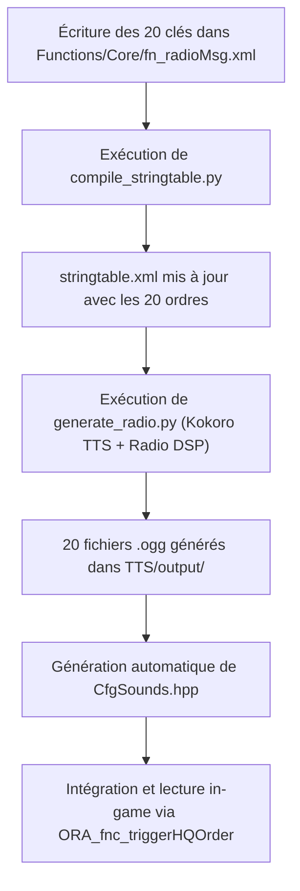

# 🎙️ Spécification Technique & Architecture : Système TTS Radio Militaire
## Mission "ORA - Air Force" (Sahrani)

---

## 1. Vue d'Ensemble & Objectifs

Ce document analyse le pipeline de synthèse vocale situé dans le répertoire `TTS/` (`generate_radio.py`) et définit la stratégie pour générer et diffuser en jeu **20 messages d'ordre de mission du QG** (en anglais militaire avec coordonnées cartographiques au format identique à celui du moteur Arma 3).

---

## 2. Analyse Détaillée du Script `generate_radio.py`

Le script `generate_radio.py` est un générateur audio de pointe qui combine la synthèse neuronale **Kokoro** avec une chaîne de traitement numérique du signal (DSP) pour recréer l'acoustique d'un émetteur-récepteur militaire VHF/UHF sous tension.

### A. Pipeline de Synthèse Vocale (Kokoro)
- **Modèle :** `kokoro.KPipeline(lang_code="a")` (Anglais américain).
- **Voix par défaut :** `am_fenrir` (voix masculine grave, éraillée et rauque, idéale pour un opérateur radio ou un contrôleur AWACS sous stress).
  - *Alternatives disponibles :* `am_adam` (posée et autoritaire), `am_onyx` (très lourde et grave).
- **Vitesse (`KOKORO_SPEED`) :** `1.08` (débit martelé et rythmé adapté aux procédures opérationnelles).
- **Fréquence native :** 24 000 Hz, canal mono (export temporaire en WAV).

### B. Chaîne DSP de Traitement Radio (`apply_radio_effect`)
Chaque échantillon généré traverse une suite d'effets analogiques et numériques avec variation stochastique :
1. **Pitch Shifting (`pitch_factor = 0.93`) :** Abaisse légèrement le timbre pour renforcer l'aspect martial.
2. **Bit-Crushing :** Dégradation volontaire à 8 000 Hz / 8-bit (émulation de liaison radio tactique bande étroite).
3. **Double Filtrage Passe-Bande :** Passe-haut (260–380 Hz) et passe-bas (2300–3100 Hz) pour isoler la bande spectrale vocale militaire.
4. **Saturation & Hard Clipping (NumPy) :** Saturation agressive simulant la dynamique d'un micro-casque de vol écrasé par la pression sonore.
5. **Bruit & Crackles Aléatoires :** Rafales de souffle (White Noise) et crépitements intermittents non uniformes.
6. **Micro-Dropouts :** Coupures aléatoires de 5 à 15 ms simulant les interférences atmosphériques et pertes de paquets radio.
7. **Pitch Wobble :** Dérive légère de l'oscillateur (VCO) pour un grain analogique imparfait.
8. **Squelch & Roger Beep :**
   - *Entrée :* Bruit de déclenchement d'alternat (squelch in) et click d'ouverture.
   - *Sortie :* Double tonalité Roger Beep sinusoïdale (~1200 Hz) suivie du souffle de fermeture (squelch tail).
9. **Mastering & Export :** Normalisation à -3 dBFS et conversion en `.ogg` (44.1 kHz, 16-bit, format natif Arma 3).

### C. Détection et Intégration dans Arma 3
- Le script lit `stringtable.xml`, filtre les clés via `is_tts_key()`, nettoie le texte via `clean_text()` et produit automatiquement le fichier `CfgSounds.hpp`.
- ⚠️ **Point d'attention identifié :** Actuellement, `is_tts_key()` ne filtre que les préfixes `STR_Drone_`, `STR_LL_`, etc. Il doit être mis à jour pour intégrer les clés de la mission `STR_ORA_HQ_Order_`. De plus, la fonction `clean_text()` coupe le texte dès qu'elle rencontre `%1` (`re.split(r"%\d+", text)[0]`), ce qui nécessite une convention spécifique pour les coordonnées.

---

## 3. Le Format des Coordonnées : Arma 3 vs TTS

### A. Le Format Natif dans Arma 3
Dans le moteur Real Virtuality d'Arma 3, la position sur la grille cartographique est calculée via la commande SQF :
```sqf
private _gridPos = mapGridPosition _position; // Ex: "112026" (6 chiffres) ou "11232667" (8 chiffres)
```
- **Structure :** Les premiers chiffres représentent l'abscisse Est (X), les suivants l'ordonnée Nord (Y).
- **Affichage en jeu (Carte / GPS / HUD) :** Le standard visuel d'Arma 3 sépare les axes par un espace ou un tiret :
  - Format 6 chiffres (précision 100 m) : `112-026` ou `112 026`.
  - Format 8 chiffres (précision 10 m) : `1123-2667` ou `1123 2667`.

### B. Le Défi de la Prononciation TTS
Si l'on injecte la chaîne brute `"1123 2667"` dans Kokoro TTS, le modèle prononcera :
> *"One thousand one hundred twenty-three, two thousand six hundred sixty-seven."*

Ce résultat est inacceptable dans un contexte de simulation militaire. Dans la réalité opérationnelle (procédures OTAN et Armée de l'Air), **chaque chiffre d'une coordonnée de grille est épelé individuellement** :
> *"Grid one-one-two-three, two-six-six-seven."*

Pour forcer Kokoro TTS à prononcer les chiffres un par un avec un tempo radio naturel, le texte doit être formaté avec des points ou des virgules d'espacement :
```text
Texte pour Kokoro TTS : "Grid 1. 1. 2. 3.  2. 6. 6. 7."
```

### C. Architecture de Diffusion en Jeu : Les 3 Approches
Pour combiner les 20 messages radio avec des coordonnées de mission :

| Approche | Description | Avantages | Inconvénients |
| :--- | :--- | :--- | :--- |
| **1. Ordres Pré-calculés (Recommandé)** | 20 messages complets pré-générés ciblant des coordonnées stratégiques réelles de l'île de Sahrani. | Qualité audio parfaite, débit ultra-fluide, zéro latence SQF. | Les cibles correspondent à 20 positions définies. |
| **2. Modular Audio Splicing** | La voix énonce l'ordre ("*Target at grid...*"), puis un script SQF enchaîne les sons des chiffres (`num_0.ogg` à `num_9.ogg`). | 100% dynamique pour n'importe quelle coordonnée aléatoire. | Nécessite de découper 10 fichiers audio de chiffres et gérer la file d'attente sonore. |
| **3. Voix Tactique + Datalink HUD** | La voix transmet l'ordre tactique ("*Target coordinates transmitted on your datalink.*"), et les coordonnées exactes s'affichent en temps réel sur l'écran et la tâche. | Moderne (standard des chasseurs 4e/5e génération), ultra-réaliste, flexibilité totale. | La coordonnée n'est pas lue chiffre par chiffre à l'oral. |

---

## 4. Catalogue des 20 Messages d'Ordre QG (HQ Orders)

Voici les 20 ordres d'opération rédigés en anglais militaire authentique, combinant le jargon tactique de l'aviation de chasse (*CAS, Strike, SAM, BDA, Angels, Weapons Free, Ingress, Push, Pickle*) et des coordonnées formatées :

| # | Clé Stringtable | Texte Radio & Sous-titres (In-Game) | Texte Phonétique pour Kokoro TTS |
| :-: | :--- | :--- | :--- |
| **01** | `STR_ORA_HQ_Order_01` | "Victor-One, HQ. Urgent CAS needed. Hostile armor advancing on grid 1123-2667. Weapons free." | "Victor-One, HQ. Urgent CAS needed. Hostile armor advancing on grid 1. 1. 2. 3.  2. 6. 6. 7. Weapons free." |
| **02** | `STR_ORA_HQ_Order_02` | "Victor-One, Overlord. Enemy mobile SAM active at grid 0842-1955. Suppress immediately." | "Victor-One, Overlord. Enemy mobile SAM active at grid 0. 8. 4. 2.  1. 9. 5. 5. Suppress immediately." |
| **03** | `STR_ORA_HQ_Order_03` | "Victor-One, HQ. Confirmed enemy command post located at grid 1420-2188. Deliver ordnance." | "Victor-One, HQ. Confirmed enemy command post located at grid 1. 4. 2. 0.  2. 1. 8. 8. Deliver ordnance." |
| **04** | `STR_ORA_HQ_Order_04` | "Victor-One, Overlord. Friendly convoy ambushed at grid 0915-1732. Provide immediate gun run." | "Victor-One, Overlord. Friendly convoy ambushed at grid 0. 9. 1. 5.  1. 7. 3. 2. Provide immediate gun run." |
| **05** | `STR_ORA_HQ_Order_05` | "Victor-One, HQ. High-value vehicle convoy spotted at grid 1604-2891. Intercept and destroy." | "Victor-One, HQ. High-value vehicle convoy spotted at grid 1. 6. 0. 4.  2. 8. 9. 1. Intercept and destroy." |
| **06** | `STR_ORA_HQ_Order_06` | "Victor-One, Overlord. Enemy artillery battery firing from grid 0733-2041. Counter-battery strike cleared." | "Victor-One, Overlord. Enemy artillery battery firing from grid 0. 7. 3. 3.  2. 0. 4. 1. Counter-battery strike cleared." |
| **07** | `STR_ORA_HQ_Order_07` | "Victor-One, HQ. Hostile ammunition depot identified at grid 1289-1456. Level the structures." | "Victor-One, HQ. Hostile ammunition depot identified at grid 1. 2. 8. 9.  1. 4. 5. 6. Level the structures." |
| **08** | `STR_ORA_HQ_Order_08` | "Victor-One, Overlord. Early warning radar active at grid 1811-2304. Ingress low and neutralize." | "Victor-One, Overlord. Early warning radar active at grid 1. 8. 1. 1.  2. 3. 0. 4. Ingress low and neutralize." |
| **09** | `STR_ORA_HQ_Order_09` | "Victor-One, HQ. Enemy troop concentration dug in at grid 0654-1820. Neutralize the perimeter." | "Victor-One, HQ. Enemy troop concentration dug in at grid 0. 6. 5. 4.  1. 8. 2. 0. Neutralize the perimeter." |
| **10** | `STR_ORA_HQ_Order_10` | "Victor-One, Overlord. Fast attack missile craft detected off coast at grid 1028-2549. Strike cleared." | "Victor-One, Overlord. Fast attack missile craft detected off coast at grid 1. 0. 2. 8.  2. 5. 4. 9. Strike cleared." |
| **11** | `STR_ORA_HQ_Order_11` | "Victor-One, HQ. Hostile patrol boat blocking sea lane at grid 0512-1387. Sink the vessel." | "Victor-One, HQ. Hostile patrol boat blocking sea lane at grid 0. 5. 1. 2.  1. 3. 8. 7. Sink the vessel." |
| **12** | `STR_ORA_HQ_Order_12` | "Victor-One, Overlord. Attack helicopter FARP operating at grid 1370-2914. Eliminate all grounded assets." | "Victor-One, Overlord. Attack helicopter FARP operating at grid 1. 3. 7. 0.  2. 9. 1. 4. Eliminate all grounded assets." |
| **13** | `STR_ORA_HQ_Order_13` | "Victor-One, HQ. Mechanized column moving through pass at grid 0896-1623. Halt their advance." | "Victor-One, HQ. Mechanized column moving through pass at grid 0. 8. 9. 6.  1. 6. 2. 3. Halt their advance." |
| **14** | `STR_ORA_HQ_Order_14` | "Victor-One, Overlord. Hostile heavy armor digging in at grid 1105-2248. Precision strike authorized." | "Victor-One, Overlord. Hostile heavy armor digging in at grid 1. 1. 0. 5.  2. 2. 4. 8. Precision strike authorized." |
| **15** | `STR_ORA_HQ_Order_15` | "Victor-One, HQ. Communications relay station operational at grid 1532-2701. Destroy the tower." | "Victor-One, HQ. Communications relay station operational at grid 1. 5. 3. 2.  2. 7. 0. 1. Destroy the tower." |
| **16** | `STR_ORA_HQ_Order_16` | "Victor-One, Overlord. Heavy mortar battery shelling airbase from grid 0781-1992. Silence those tubes." | "Victor-One, Overlord. Heavy mortar battery shelling airbase from grid 0. 7. 8. 1.  1. 9. 9. 2. Silence those tubes." |
| **17** | `STR_ORA_HQ_Order_17` | "Victor-One, HQ. Hostile fuel storage facility detected at grid 1743-2460. Ignite the fuel tanks." | "Victor-One, HQ. Hostile fuel storage facility detected at grid 1. 7. 4. 3.  2. 4. 6. 0. Ignite the fuel tanks." |
| **18** | `STR_ORA_HQ_Order_18` | "Victor-One, Overlord. Armored staging area located at grid 0987-1512. Ingress hot, pickle on target." | "Victor-One, Overlord. Armored staging area located at grid 0. 9. 8. 7.  1. 5. 1. 2. Ingress hot, pickle on target." |
| **19** | `STR_ORA_HQ_Order_19` | "Victor-One, HQ. Fortified checkpoint cutting MSR at grid 1214-1885. Clear the road for allied forces." | "Victor-One, HQ. Fortified checkpoint cutting MSR at grid 1. 2. 1. 4.  1. 8. 8. 5. Clear the road for allied forces." |
| **20** | `STR_ORA_HQ_Order_20` | "Victor-One, Overlord. Forward operational headquarters established at grid 1498-2073. Decapitate command." | "Victor-One, Overlord. Forward operational headquarters established at grid 1. 4. 9. 8.  2. 0. 7. 3. Decapitate command." |

---

## 5. Modifications Requises dans `generate_radio.py`

Pour que le script prenne en charge ces 20 nouveaux messages sans perturber le projet :

### 1. Mise à jour du filtre de clés (`is_tts_key`)
Ajouter le préfixe `STR_ORA_` à la détection :
```python
def is_tts_key(key_id):
    prefixes = ("STR_Drone_", "STR_LL_Heli_", "STR_LL_Msg_", "STR_TAG_Msg_", "STR_LL_Radio_", "STR_ORA_")
    if key_id.startswith(prefixes):
        return True
    return False
```

### 2. Adaptation de la prononciation des coordonnées
Ajouter une passe de normalisation automatique dans `clean_text` pour séparer les chiffres des coordonnées si la clé contient un format `XXXX-YYYY` :
```python
def format_grid_for_tts(text):
    # Remplace un format de grille "1123-2667" par "1. 1. 2. 3.  2. 6. 6. 7."
    def replace_grid(match):
        digits = match.group(0).replace("-", " ")
        return " ".join([f"{d}." for d in digits if d.isdigit()])
    return re.sub(r"\b\d{3,4}[-\s]\d{3,4}\b", replace_grid, text)
```

---

## 6. Implémentation SQF : Sélection Aléatoire et Déclenchement In-Game

Pour déclencher un ordre aléatoire parmi les 20 en cours de mission, voici la fonction modulaire à intégrer dans `Functions/Core/fn_triggerHQOrder.sqf` :

```sqf
/*
    Auteur: ORA SQF Architect
    Description:
        Sélectionne et diffuse un ordre de mission aléatoire du QG parmi les 20 messages,
        avec synchronisation audio radio et affichage du sous-titre HUD.
    Paramètres:
        Aucun
    Retour:
        [String] - Clé de l'ordre sélectionné
    Exemple:
        [] call ORA_fnc_triggerHQOrder;
*/
if (!hasInterface) exitWith { "" };

// Sélection d'un identifiant aléatoire entre 1 et 20
private _orderNum = floor (random 20) + 1;
private _orderNumStr = if (_orderNum < 10) then { format ["0%1", _orderNum] } else { str _orderNum };
private _keyId = format ["STR_ORA_HQ_Order_%1", _orderNumStr];

// Récupération du texte localisé
private _messageText = localize _keyId;

// Diffusion avec l'émetteur radio QG et le son TTS généré
[
    "OVERLORD",
    _messageText,
    _keyId
] call ORA_fnc_radioMsg;

// Enregistrement de l'ordre actif dans l'état de la mission
missionNamespace setVariable ["ORA_currentHQOrder", _keyId, true];

_keyId
```

---

## 7. Workflow de Production Recommandé



